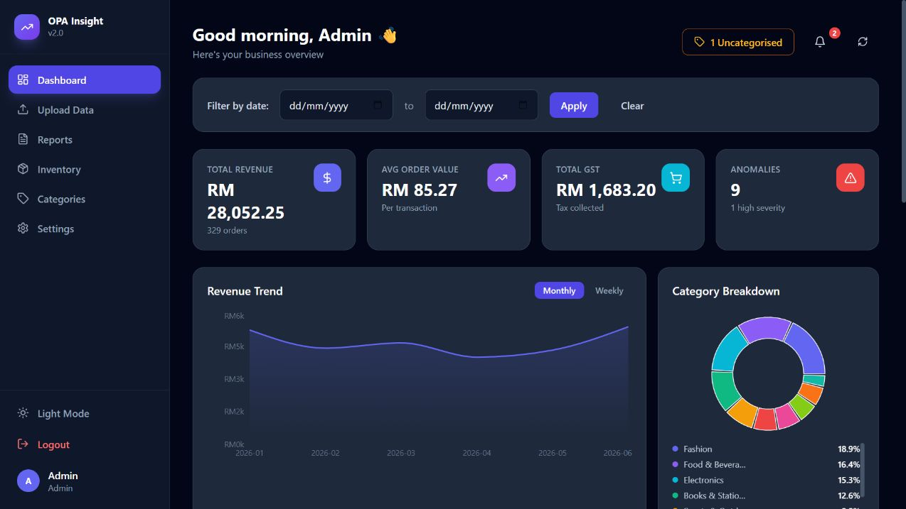

# OPA Insight V2

**Order Processing & Analytics** — an individual Computer Science final-year project by **Keoh Ying Ee (Wayne), 2026**.

A full-stack application that turns SME order files into cleaned records, category breakdowns, anomaly signals and downloadable reports. Developed and personally tested with AI-assisted coding.

**[Try the compact browser demo](https://wayne-resume-journey.wayne-portfolio.workers.dev/#work)** · **[Portfolio source](https://github.com/waynekeoh0829/wayne-resume-journey)** · **[GitHub profile](https://github.com/waynekeoh0829)**



## What the project does

| Stage | Function |
| --- | --- |
| Import | CSV, Excel (`.xlsx` / `.xls`) and Word (`.docx`) order tables, plus manual entry |
| Validate and clean | Column aliases, required fields, date/number cleaning and duplicate handling |
| Categorise | Keyword matching, RapidFuzz matching and saved category corrections |
| Analyse | Revenue KPIs, trends, category mix, top products and period comparisons |
| Review | Rule/statistical anomaly flags, inventory velocity and restock suggestions |
| Report | Generated narrative insights, recommendations, PDF and CSV exports |
| Manage | Login/profile, categories, notifications and light/dark theme |

The original UI uses the term **AI insights**. These insights are rule-based narrative generation, and categorisation uses keywords and fuzzy matching. This application does **not** call an LLM, train a model or require an AI API key. The portfolio's Ask Wayne chatbot is a separate system.

## Technology

- **Backend:** Python, Flask, SQLite, Pandas, RapidFuzz, ReportLab, python-docx and openpyxl.
- **Frontend:** React 18, Vite, Tailwind CSS, Recharts, Axios and Lucide.
- **Data:** a local SQLite database, recreated on first launch. Generated CSV/DOCX samples are included; original user data is not.

## Run the complete application

Prerequisites: **Python 3.11** (tested), **Node.js 20.19+ or 24** and npm. Run the backend and frontend in separate terminals.

### Backend

From the repository root:

```bash
python -m venv .venv
```

Activate the environment with `.venv\Scripts\Activate.ps1` on Windows PowerShell, or `source .venv/bin/activate` on macOS/Linux. Then:

```bash
python -m pip install -r backend/requirements.txt
python backend/app.py
```

Backend: **http://127.0.0.1:5000**. The application creates its database and default category keywords automatically.

### Frontend

```bash
cd frontend
npm ci
npm run dev
```

Open **http://localhost:5173**. Vite proxies `/api` requests to Flask on port 5000.

**Disposable local demo login:** `admin@opa.com` / `admin123`.

This is a local academic demo. Use synthetic data and do not enter a real password. Read [SECURITY.md](SECURITY.md) before considering any public deployment.

## A five-minute walkthrough

1. Sign in using the demo account.
2. Open Upload and select `sample_orders_2026.csv` from this repository.
3. Process the file to run the cleaning and categorisation pipeline.
4. Open Dashboard to explore KPIs, trends, categories and anomaly signals.
5. Try Reports, export a PDF/CSV, and explore inventory and category correction.

The sample intentionally includes imperfect records to exercise cleaning and anomaly rules. All sample orders are generated, not customer data. Regenerate them from the root with `python generate_sample.py`.

Required columns: `order_id`, `product_name`, `quantity`, `revenue`, `gst`, `date`. Common spaced aliases are supported. Use ISO dates (`YYYY-MM-DD`). Although the legacy upload UI also lists `.doc`, the parser uses python-docx: convert old binary Word documents to `.docx` first.

## Repository map

```text
backend/
  app.py                 Flask routes and workflow coordination
  database.py            Schema, local demo account and keyword seed
  modules/
    validator.py         File reading and column checks
    cleaner.py           Normalisation and cleaning
    categoriser.py       Keywords, fuzzy matching and corrections
    analytics.py         KPIs, trends and comparisons
    anomaly.py           Data-quality and statistical signals
    insights.py          Rule-based narrative summaries
    recommendations.py   Rule-based suggestions
    inventory.py         Product movement and restock analysis
    pdf_generator.py     Report export
frontend/src/
  pages/                 Dashboard, upload, inventory, reports, settings
  components/            Layout, navigation, KPI cards and charts
  context/               Authentication and theme state
  utils/api.js           Shared API client
tests/test_workflow.py    Temporary-database end-to-end API smoke test
generate_sample.py       Reproducible synthetic sample generator
```

All original application modules are included. Installed dependencies, existing SQLite databases, historical uploads, Python caches and secrets are intentionally excluded. The original launch helpers remain available; the two-terminal setup above is the recommended reproducible path.

## Validation

```bash
python -m unittest discover -s tests -v
cd frontend
npm ci
npm run build
```

The workflow smoke test checks authentication, sample upload, processing, analytics, anomaly/insight/inventory routes and CSV/PDF export using a temporary database. It does not touch the developer's existing database. Frontend build is checked separately. This is not a full security or browser test suite.

## Scope and next steps

The current code is an academic prototype. Production hardening, cloud deployment, stronger authentication, tenant isolation, file validation and broader automated coverage remain future work; see [SECURITY.md](SECURITY.md). Shopee/Lazada integration, OCR, scheduled email and multi-currency support are ideas, not implemented features.

**Author:** [Wayne / Keoh Ying Ee](https://github.com/waynekeoh0829) · [Portfolio](https://wayne-resume-journey.wayne-portfolio.workers.dev)
